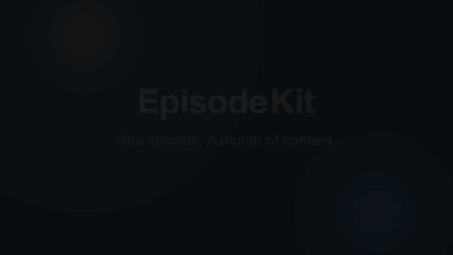

# EpisodeKit

[](https://github.com/gitAbid/episodekit/actions/workflows/ci.yml)

**Live: <https://episodekit.vercel.app>** · **Sprint map (live):
<https://episodekit.vercel.app/map>** · **Built in the open** — every decision,
day log, and test is in this repo (`docs/day-logs/`), produced by an autonomous
daily build loop running through November 2026.



*38-second narrated demo: [episodekit.vercel.app](https://episodekit.vercel.app)*

**Sample output, unedited** — from the CC0 demo transcript in
`docs/samples/demo-episode.txt` (see it rendered:
[samples page](https://episodekit.vercel.app/samples)):

> **Titles:** Attention and Version · The Attention We Keep Avoiding · Attention
> for Ordinary Weeks · Focus Changes Everything · …
> **Summary:** Attention compounds, the cost of an interruption is not the five
> minutes it takes… calendars beat to-do lists because a to-do item is a wish
> while a calendar block is a promise…
> **Social pull-quote:** "We budget our dollars, we calendar our hours, and
> then we let anyone with a notification spend our attention for free."

**One episode → a month of content.** EpisodeKit turns a podcast episode (audio
file or transcript) into the full content package a creator spends hours
writing every week: an article-ready writeup, community discussion kit, 5-day
email series, social captions with pull quotes, a summary, and title ideas.

- Positioning/pricing: Pro **$19/mo** (incumbents Podsqueeze $9–89, Castmagic
  $19–699) — see `RESEARCH.md` (church-vertical origins + Day-7 pivot note).
- **Hard product rule:** religion-neutral — no religious-domain content
  anywhere (enforced by a permanent test gate).
- Plan: `ROADMAP.md` · daily log: `docs/day-logs/` · changelog: `CHANGELOG.md`.
- Sprint: 2026-10-24 → 2026-11-24, one autonomous build session every day 09:00
  (also updates `site/status.json`, which powers the live sprint map).

## Layout

```
site/                 # static site, no build step (landing, app, free tools, map)
  tools/              # free no-signup tool pages (SEO wedge)
  status.json         # live sprint-map data (updated by the daily build loop)
api/                  # Vercel serverless functions
engine/               # deterministic content-suite engine + GLM path + tests
docs/                 # day logs, research, samples, submission kits
```

## Develop & test

```bash
npm test                        # engine + ASR + license tests (60 total)
npm run sample                  # regenerate the committed sample package
node scripts/dev-server.mjs     # local site + API on :8931
```

## Env vars (optional; product degrades gracefully without them)

- `GLM_API_KEY` — GLM chat completions (AI-enhanced artifacts)
- `ASR_API_KEY` / `ASR_PROVIDER` — audio transcription (Deepgram or Groq)
- `LS_WEBHOOK_SECRET`, `LS_PRO_URL`, `LS_STUDIO_URL`, `LS_FOUNDER_URL`,
  `LS_VARIANTS` — Lemon Squeezy payment rail (license keys activate instantly)

## Honesty rules for agents working here

See "Hard rules" in `ROADMAP.md` — no fabricated progress or testimonials, no
spam, verbatim-quote integrity, and the religion-neutral product constraint.
